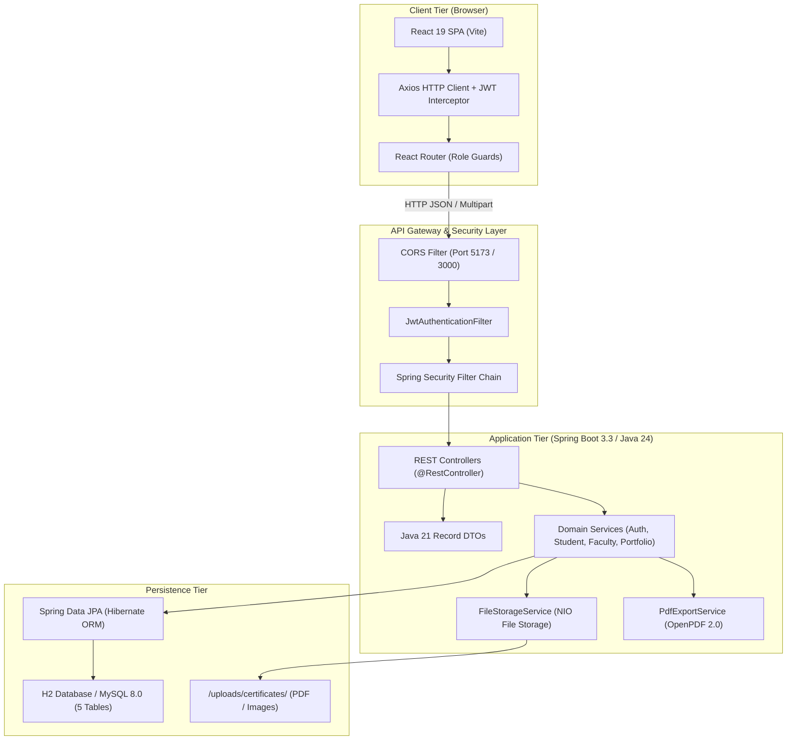
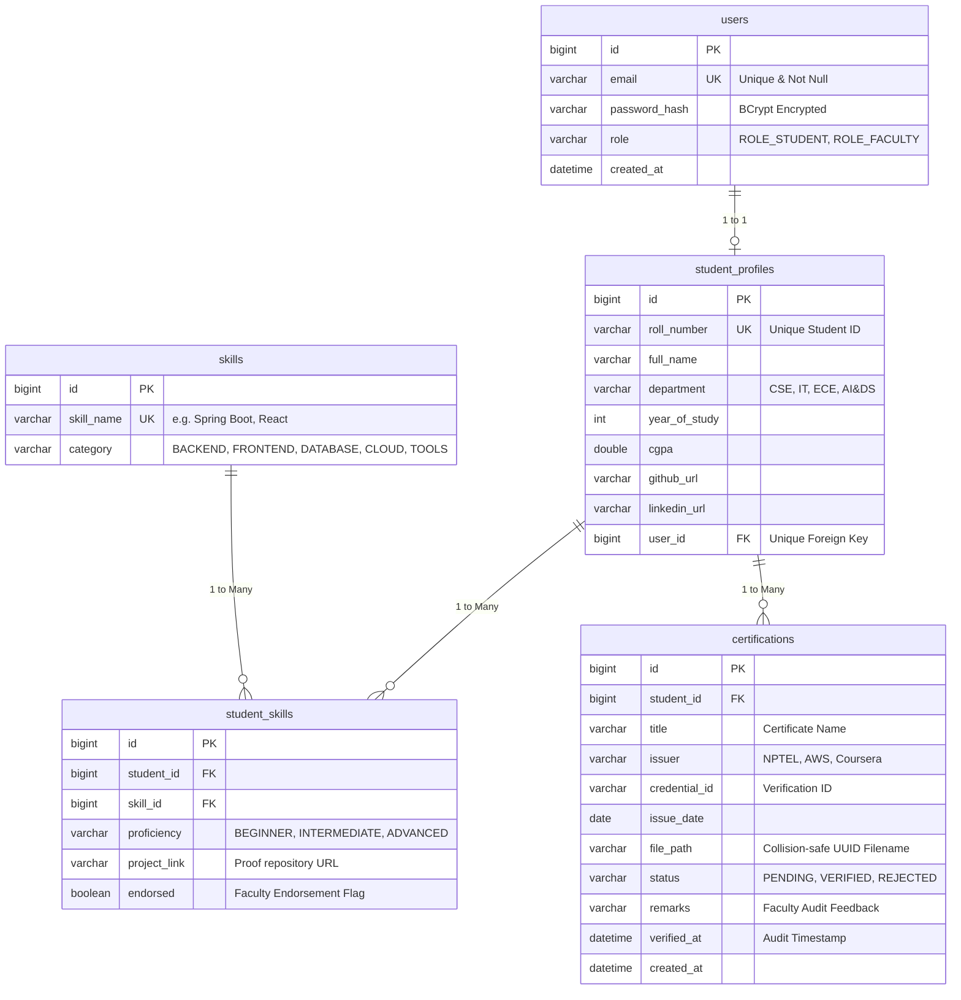
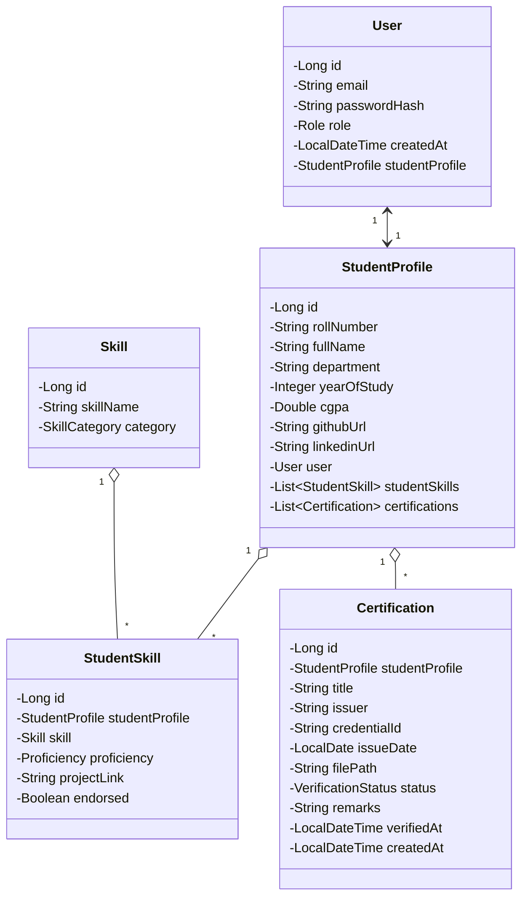
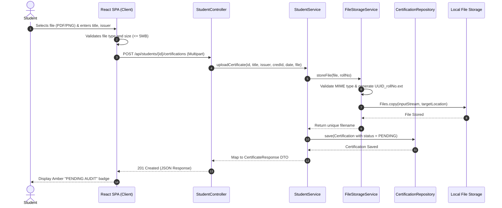
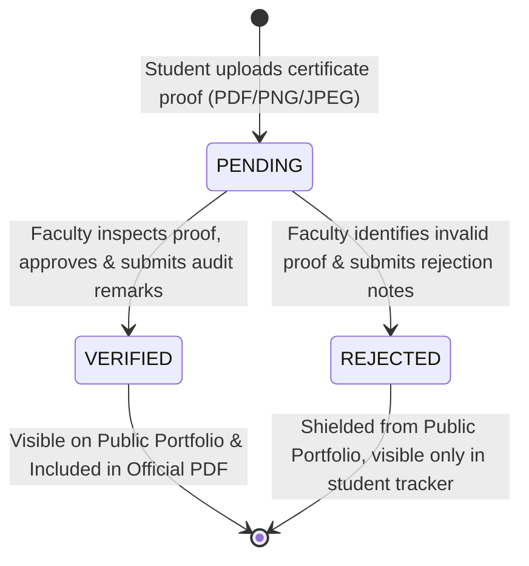

# CertiFolio: System Design & Architecture Documentation

This document describes the software architecture, data design, interaction models, and security mechanics for **CertiFolio (Student Skill & Certification Registry)**.

---

## 1. Architectural Overview & System Topology

CertiFolio adheres to a **Decoupled Client-Server Architecture**. The user interface operates as an independent Single Page Application (SPA), communicating with a stateless Spring Boot RESTful API service.



---

## 2. Relational Database Design (Entity-Relationship Model)

The persistence layer normalizes data across five core tables to eliminate redundancy while preserving referential integrity:

1. `users`: Stores core credentials, role authorizations, and creation timestamps.
2. `student_profiles`: Stores academic standing (CGPA, year of study, department) and external portfolio links.
3. `skills`: Master catalog of industry technologies across categories (Backend, Frontend, Database, Cloud, Tools).
4. `student_skills`: Associative join table linking students to skills with specific proficiency levels (`BEGINNER`, `INTERMEDIATE`, `ADVANCED`) and proof repository links.
5. `certifications`: Stores metadata for uploaded student certificates, audit remarks, status, and immutable verification timestamps.



---

## 3. Domain Model Class Diagram

The following diagram illustrates the relationship between JPA entities, repositories, and services:



---

## 4. Sequence Diagrams

### 4.1 Certificate Upload Workflow (Multipart Ingestion)

This diagram details the sequence when a student uploads an academic certificate proof:



---

### 4.2 Faculty Audit & Verification Workflow

This diagram outlines how faculty members audit proofs and transition the state machine:

```mermaid
sequenceDiagram
    autonumber
    actor Faculty
    participant UI as Faculty Console (React)
    participant FC as FacultyController
    participant FS as FacultyService
    participant CR as CertificationRepository

    Faculty->>UI: Views Pending Verification Queue
    UI->>FC: GET /api/faculty/certifications/pending
    FC->>FS: getPendingCertificates()
    FS->>CR: findByStatusOrderByCreatedAtDesc(PENDING)
    CR-->>FS: Return List<Certification>
    FS-->>FC-->>UI: Display unverified submissions table
    Faculty->>UI: Clicks "Inspect Proof" (Modal Previewer)
    Faculty->>UI: Selects "Approve" & enters audit remarks
    UI->>FC: PATCH /api/faculty/certifications/{id}/verify
    FC->>FS: verifyCertificate(certId, request)
    FS->>CR: findById(certId)
    CR-->>FS: Found Certification
    FS->>FS: cert.setStatus(VERIFIED)
    FS->>FS: cert.setRemarks(remarks)
    FS->>FS: cert.setVerifiedAt(LocalDateTime.now())
    FS->>CR: save(cert)
    CR-->>FS: Persisted
    FS-->>FC-->>UI: 200 OK (Updated DTO)
    UI-->>Faculty: Queue item resolved, status becomes VERIFIED
```

---

### 4.3 Public Portfolio & OpenPDF Generation

This diagram illustrates how public recruiters query credentials and trigger on-the-fly PDF creation:

```mermaid
sequenceDiagram
    autonumber
    actor Recruiter as Recruiter / Evaluator
    participant UI as Public Portfolio Page
    participant PC as PortfolioController
    participant PS as PortfolioService
    participant PDF as PdfExportService
    participant CR as CertificationRepository

    Recruiter->>UI: Accesses /portfolio/23CS042
    UI->>PC: GET /api/portfolio/23CS042
    PC->>PS: getPublicPortfolio("23CS042")
    PS->>CR: findByRollNoAndStatus("23CS042", VERIFIED)
    Note over PS,CR: Architectural Safeguard: SQL-Level Isolation
    CR-->>PS: Return strictly VERIFIED certificates
    PS-->>PC-->>UI: Return PublicPortfolioResponse
    UI-->>Recruiter: Renders verified profile & skills
    Recruiter->>UI: Clicks "Download Official Portfolio PDF"
    UI->>PC: GET /api/portfolio/23CS042/pdf
    PC->>PDF: generatePortfolioPdf("23CS042")
    PDF->>PS: Fetch verified profile
    PS-->>PDF: Return data
    PDF->>PDF: Construct OpenPDF Document (Bio, Skills, Certs Table, Audit Stamp)
    PDF-->>PC: Return byte[] (application/pdf)
    PC-->>UI: Stream PDF with Content-Disposition
    UI-->>Recruiter: Browser initiates PDF download
```

---

## 5. State Machine Diagram: Certification Lifecycle



---

## 6. Security Architecture & RBAC

The system employs a stateless security model with Role-Based Access Control (RBAC):

1. **Authentication Flow**:
   - The client submits email/password to `/api/auth/login`.
   - Credentials are confirmed against BCrypt hashes stored in the database.
   - Upon successful verification, a cryptographically signed HMAC-SHA256 JWT is generated with claims (`userId`, `email`, `role`, `exp`).
2. **Request Authorization**:
   - For every subsequent HTTP request, `JwtAuthenticationFilter` intercepts the request header (`Authorization: Bearer <token>`).
   - The token signature and expiration date are validated.
   - A `UsernamePasswordAuthenticationToken` with granted authorities (`ROLE_STUDENT`, `ROLE_FACULTY`, `ROLE_ADMIN`) is placed in the Spring `SecurityContextHolder`.
3. **Route Protection**:
   - `/api/students/**`: Accessible to authenticated students.
   - `/api/faculty/**`: Restricted to authenticated faculty and administrators.
   - `/api/portfolio/**`: Publicly accessible to permit external portfolio sharing.

---

## 7. Architectural Safeguards (Viva-Voce Standout Design)

Evaluators frequently ask how CertiFolio guarantees against credential falsification. The system implements two architectural safeguards:

1. **SQL-Level Query Isolation**:
   The public portfolio does not rely on frontend filtering. Instead, the backend repository executes:
   ```sql
   SELECT c FROM Certification c 
   WHERE c.studentProfile.rollNumber = :rollNo 
     AND c.status = 'VERIFIED'
   ```
   Unverified (`PENDING`) or fraudulent (`REJECTED`) submissions are never serialized or transmitted across the network to public clients.

2. **Immutable Audit Timestamping**:
   Every approved certificate permanently records:
   - The faculty auditor's remarks.
   - The exact timestamp (`verified_at`) recorded by the institutional server.
   - A digital certificate hash reference embedded in the OpenPDF transcript.
