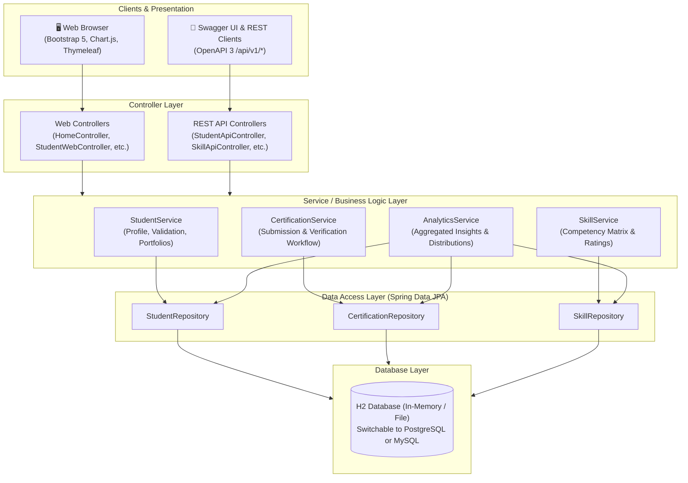
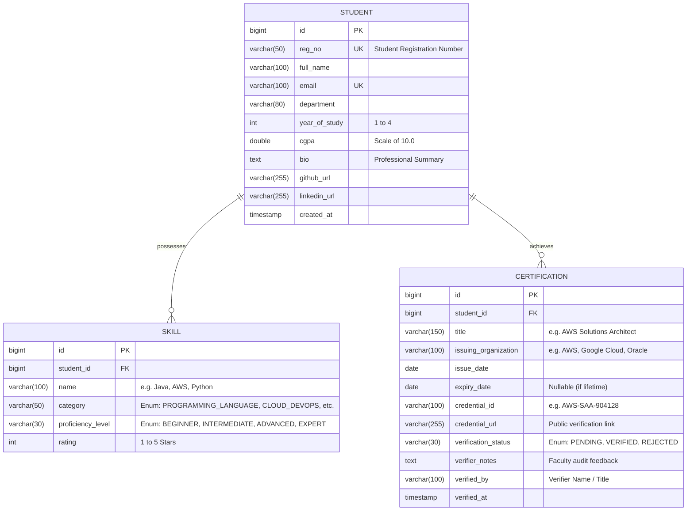
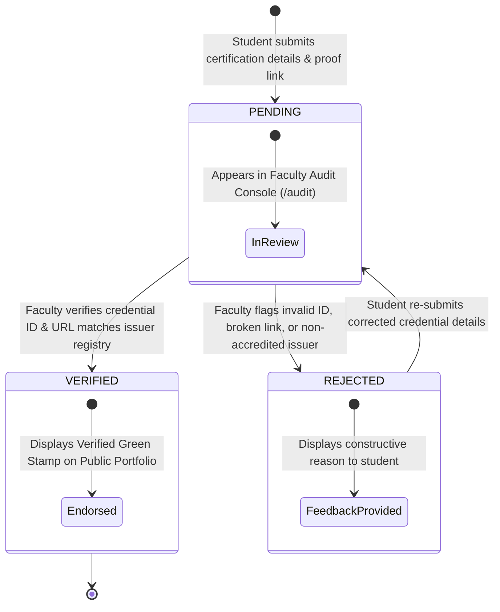
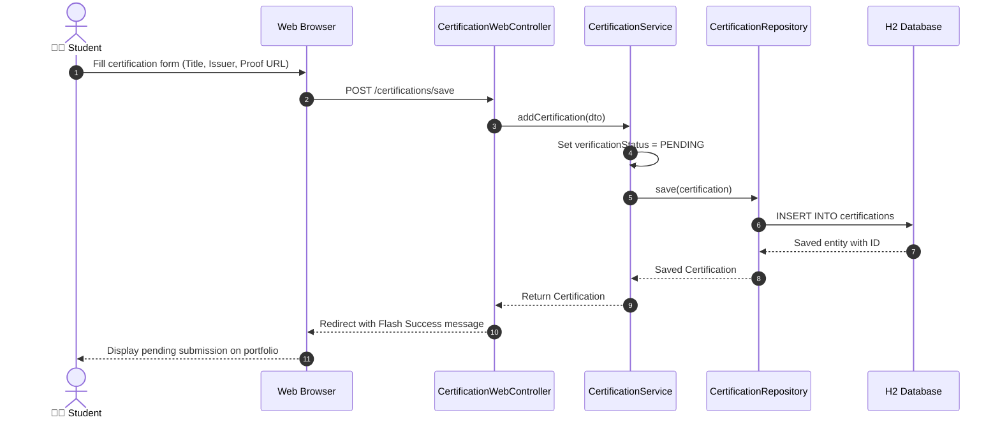

# 🏗️ CertiFolio - System Design Documentation

This document describes the architectural design, domain models, entity relationships, verification state machine, and data flows of the **CertiFolio Student Skill & Certification Portfolio Registry application**.

---

## 📑 Table of Contents
1. [Architectural Overview](#1-architectural-overview)
2. [Domain Model & Entity Relationship (ER) Diagram](#2-domain-model--entity-relationship-er-diagram)
3. [Certification Lifecycle & Verification State Machine](#3-certification-lifecycle--verification-state-machine)
4. [Sequence Diagrams](#4-sequence-diagrams)
   - [Student Submits Certification](#41-certification-submission-workflow)
   - [Faculty Audits & Verifies Submission](#42-faculty-audit--verification-workflow)
5. [User Interface & Presentation Design](#5-user-interface--presentation-design)
6. [Data Persistence & Migration Strategy](#6-data-persistence--migration-strategy)
7. [Security & Validation Architecture](#7-security--validation-architecture)

---

## 1. Architectural Overview

CertiFolio follows the classic, enterprise-proven **3-Tier Layered Architecture (MVC + Service Layer + Repository Pattern)**.



### Architectural Layer Responsibilities
- **Presentation Layer (Web UI + REST API)**:
  - Renders server-side HTML with Thymeleaf, responsive Bootstrap 5 styling, FontAwesome icons, and Chart.js dashboards.
  - Serves headless JSON APIs under `/api/v1/...` for external systems or frontend SPAs.
- **Service Layer**:
  - Encapsulates business logic, transactional boundaries (`@Transactional`), verification transitions, and duplicate prevention.
- **Repository Layer (Spring Data JPA)**:
  - Relational mapping, custom JPQL queries, and database abstraction over Hibernate 6.
- **Database Layer**:
  - Embedded H2 database with Web Console (`/h2-console`) enabled for development; fully decoupled to connect to PostgreSQL or MySQL via standard connection properties.

---

## 2. Domain Model & Entity Relationship (ER) Diagram



### Key Relationships
- **Student to Skill**: 1-to-Many (`CascadeType.ALL`, `orphanRemoval = true`). A student can possess multiple categorized skills with independent proficiencies.
- **Student to Certification**: 1-to-Many (`CascadeType.ALL`, `orphanRemoval = true`). A student can hold multiple industry certifications, each progressing through the verification lifecycle.

---

## 3. Certification Lifecycle & Verification State Machine

Certifications enter a strict verification workflow to maintain academic integrity and recruiter trust:



---

## 4. Sequence Diagrams

### 4.1 Certification Submission Workflow



### 4.2 Faculty Audit & Verification Workflow

```mermaid
sequenceDiagram
    autonumber
    actor Faculty as 👩‍🏫 Faculty Verifier
    participant Browser as Web Browser
    participant Controller as VerificationWebController
    participant Service as CertificationService
    participant Repo as CertificationRepository
    participant DB as H2 Database

    Faculty->>Browser: Open Audit Console (/audit)
    Browser->>Controller: GET /audit
    Controller->>Service: getPendingCertifications()
    Service->>Repo: findByVerificationStatus(PENDING)
    Repo-->>Service: List of pending submissions
    Service-->>Controller: Model attributes
    Controller-->>Browser: Render Audit Page

    Faculty->>Browser: Click "Verify & Stamp" (or "Reject with notes")
    Browser->>Controller: POST /audit/decision/{id} (status=VERIFIED, notes, verifier)
    Controller->>Service: verifyCertification(id, decision)
    Service->>Service: Update status, verifiedBy, verifiedAt timestamp
    Service->>Repo: save(certification)
    Repo->>DB: UPDATE certifications SET status='VERIFIED' ...
    DB-->>Repo: Updated row
    Repo-->>Service: Certification
    Service-->>Controller: Return
    Controller-->>Browser: Redirect with confirmation
    Browser-->>Faculty: Queue updated; certification moves to verified ledger
```

---

## 5. User Interface & Presentation Design

### Design Principles
- **Modern Simplicity**: Clean typography, card-based layouts, and intuitive color hierarchy.
- **Recruiter Ready**: Public student portfolio URL (`/students/{id}/portfolio`) designed for quick evaluation with visual skill meters and verified credential proofs.
- **Print & PDF Support**: Tailored `@media print` CSS rules in `custom.css` that hide navigation controls and format pages for printing or PDF exports during campus placement drives.
- **Interactive Visualizations**: Chart.js graphs visually break down institutional talent analytics into bar and doughnut charts.

---

## 6. Data Persistence & Migration Strategy

### Current Setup (Embedded H2)
The application currently runs on an embedded H2 database for zero-setup execution:
```yaml
spring:
  datasource:
    url: jdbc:h2:mem:certifoliodb;DB_CLOSE_DELAY=-1;DB_CLOSE_ON_EXIT=FALSE
    driver-class-name: org.h2.Driver
    username: sa
    password: 
```

### Migration to PostgreSQL / MySQL
To switch to an external database for production:
1. Add the database driver to `pom.xml`:
   ```xml
   <dependency>
       <groupId>org.postgresql</groupId>
       <artifactId>postgresql</artifactId>
       <scope>runtime</scope>
   </dependency>
   ```
2. Update `src/main/resources/application.yml`:
   ```yaml
   spring:
     datasource:
       url: jdbc:postgresql://localhost:5432/certifolio_db
       username: postgres
       password: secretpassword
     jpa:
       hibernate:
         ddl-auto: update
   ```

---

## 7. Security & Validation Architecture

- **Jakarta Bean Validation (`@Valid`)**:
  - Request DTOs validate `@NotBlank`, `@Email`, `@NotNull`, and rating boundaries (`@Min(1)`, `@Max(5)`).
- **SQL Injection Prevention**:
  - All queries in `StudentRepository`, `SkillRepository`, and `CertificationRepository` utilize Hibernate parameterized queries (`:param`), eliminating raw SQL injection vectors.
- **XSS Mitigation**:
  - Thymeleaf automatically escapes HTML by default using `th:text`, protecting the web interface from script injection in student bio and comments.
- **Unique Constraints**:
  - `regNo` and `email` columns enforce uniqueness at both database schema and service layers.
